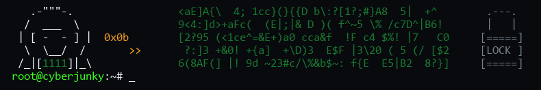

<!-- Banner -->

  

<!-- Projects Section -->
<h2 align="center">🚀 My Projects - this is where most of my free time is spent -</h2>

### 🌍 Websites

| Project | Description |
|---------|-------------|
| [freqle.org](https://freqle.org) | Freqtrade strategy lab |
| [cyberjunky.nl](https://cyberjunky.nl) | My website (needs an update) |
| [ghost‑to‑jekyll](https://github.com/cyberjunky/ghost-to-jekyll) | Toolkit to convert a website from Ghost to Jekyll/GitHub pages |

### 📈 Trading

| Project | Description |
|---------|-------------|
| [blofin‑proxy](https://github.com/cyberjunky/blofin-proxy) | Caching REST proxy for BloFin fed by websockets: Freqtrade's candles, tickers and order books come from the stream, so the bots stay under Cloudflare's rate limits |
| [frequi](https://github.com/cyberjunky/frequi) | Redesigned FreqUI, the web interface of Freqtrade: new layout and themes, a reworked candle chart, reliable live updates over the WebSocket, and bug fixes |

### 🏠 Home Assistant Core Integrations

| Project | Description |
|---------|-------------|
| [FireServiceRota](https://www.home-assistant.io/integrations/fireservicerota/) | FireServiceRota scheduling and dispatching system for firefighters |

### 📡 Home Assistant Apps (Add-ons)

| &nbsp;&nbsp;&nbsp;&nbsp;&nbsp;&nbsp;&nbsp;&nbsp;&nbsp;&nbsp;&nbsp;&nbsp;&nbsp;&nbsp;&nbsp;&nbsp;Project&nbsp;&nbsp;&nbsp;&nbsp;&nbsp;&nbsp;&nbsp;&nbsp;&nbsp;&nbsp;&nbsp;&nbsp;&nbsp;&nbsp;&nbsp;&nbsp; | Description |
|---------|-------------|
| [home‑assistant‑apps](https://github.com/cyberjunky/home-assistant-apps) | My collection of Home Assistant Apps / Addons |
| ↳ [app‑dishylink](https://github.com/cyberjunky/home-assistant-apps/tree/main/app-dishylink) | Starlink dish and router dashboard with 24/7 recorded history, powered by Dishylink |
| ↳ [app‑pgadmin4](https://github.com/cyberjunky/home-assistant-apps/tree/main/app-pgadmin4) | pgAdmin 4, web-based PostgreSQL administration from the sidebar *(temporary fork of [Expaso's pgAdmin 4 add-on](https://github.com/expaso/hassos-addon-pgadmin4): improvements only, I am not the original author)* |
| ↳ [app‑timescaledb](https://github.com/cyberjunky/home-assistant-apps/tree/main/app-timescaledb) | PostgreSQL with TimescaleDB, PostGIS, pgvector, pg_cron, pgAgent and TimescaleDB Toolkit *(temporary fork of [Expaso's TimescaleDB add-on](https://github.com/expaso/hassos-addon-timescaledb): improvements only, I am not the original author)* |
| ↳ [app‑meldkamer](https://github.com/cyberjunky/home-assistant-apps/tree/main/app-meldkamer) | Receive P2000 messages from the air using an SDR dongle, includes dashboard |
| ↳ [app‑goodwe](https://github.com/cyberjunky/home-assistant-apps/tree/main/app-goodwe) | GoodWe inverter dashboard and battery controller for Home Assistant |
| ↳ [app‑tesla](https://github.com/cyberjunky/home-assistant-apps/tree/main/app-tesla) | Unofficial Tesla logger, statistics and dashboard for Home Assistant |
| ↳ [app‑toon](https://github.com/cyberjunky/home-assistant-apps/tree/main/app-toon) | Logger and dashboard for a rooted Toon thermostat: boiler, heating, energy and the Toon's own health |
| ↳ [app‑fireservicerota](https://github.com/cyberjunky/home-assistant-apps/tree/main/app-fireservicerota) | FireServiceRota / Brandweerrooster dashboard: live incident, respond, duty and history |
| ↳ [app‑nuclei](https://github.com/cyberjunky/home-assistant-apps/tree/main/app-nuclei) | Internal vulnerability scanner: CVEs, exposed services and open ports, as tickets you work through |
| ↳ [app‑arcade](https://github.com/cyberjunky/home-assistant-apps/tree/main/app-arcade) | Classic arcade games with MAME in your browser, high scores kept (bring your own ROMs) |
| ↳ [app‑chronicle](https://github.com/cyberjunky/home-assistant-apps/tree/main/app-chronicle) | Dashboard for the Chronicle integration's history in TimescaleDB: entities, charts, storage and compression |
| ↳ [app‑sdradio](https://github.com/cyberjunky/home-assistant-apps/tree/main/app-sdradio) | Software defined radio receiver with RTL-SDR or HackRF: listen in the browser, scan, and decode pagers, sensors, aircraft and ships |
| ↳ [app‑freqtrade](https://github.com/cyberjunky/home-assistant-apps/tree/main/app-freqtrade) | Dashboard for your Freqtrade trading bots: overview, a page per bot with a candle chart, live trades over the WebSocket |
| ↳ [app‑proxmox](https://github.com/cyberjunky/home-assistant-apps/tree/main/app-proxmox) | Unofficial dashboard for your Proxmox VE cluster: nodes, guests, backups with RPO and RTO, the network as VLAN lanes and a map, the firewall as a flow |
| ↳ [app‑proxmox‑bs](https://github.com/cyberjunky/home-assistant-apps/tree/main/app-proxmox-bs) | Unofficial: a real Proxmox Backup Server for your Proxmox VE backups, on the disks of this machine |
| ↳ [app‑network](https://github.com/cyberjunky/home-assistant-apps/tree/main/app-network) | Every device tracker as a live map of your network: groups and VLANs, rename in Home Assistant, who drops off, and your phones' tracks and heatmap |
| ↳ [app‑bitcoin‑node](https://github.com/cyberjunky/home-assistant-apps/tree/main/app-bitcoin-node) | Dashboard for your own Bitcoin node: chain, mempool, fees and peers from Bitcoin Core, your Lightning wallet and channels from LND, and Tor |
| ↳ [app‑mqtt](https://github.com/cyberjunky/home-assistant-apps/tree/main/app-mqtt) | The Mosquitto MQTT broker with a dashboard: clients, topics, live traffic, Home Assistant discovery and statistics |
| ↳ [app‑marshal](https://github.com/cyberjunky/home-assistant-apps/tree/main/app-marshal) | Keeps watch over your Marketplace integrations: reads their code and the packages they install for credential and data access, risky code, internet hosts and slow patterns, and ranks them |
| ↳ [app‑flipper](https://github.com/cyberjunky/home-assistant-apps/tree/main/app-flipper) | A workbench for a Flipper Zero on USB: see its screen, press its buttons, manage its files, and write, build and run apps on it |
| ↳ [app‑scanner](https://github.com/cyberjunky/home-assistant-apps/tree/main/app-scanner) | Makes a USB or network scanner a scanner for the whole house: every option of the scanner, batches, searchable PDFs in an archive, and copies to a network share |
| ↳ [app‑dashboard](https://github.com/cyberjunky/home-assistant-apps/tree/main/app-dashboard) | A wall tablet dashboard in a calm, typographic style that you design by dragging: sensors, lights, climate, charts, calendars and cameras on pages of your own, with the doorbell's camera and a dimmed night |
| ↳ [app‑knxray](https://github.com/cyberjunky/home-assistant-apps/tree/main/app-knxray) | Unofficial, read-only X-ray of a KNX installation: bus monitor, long-term recording with charts and statistics, and checks of the bus, the ETS project and Home Assistant's KNX entities against each other |
| ↳ [app‑lottery](https://github.com/cyberjunky/home-assistant-apps/tree/main/app-lottery) | Solo mining as the lottery it is: your odds of a block, how close your best share came, and every Bitaxe, NerdQAxe or Lucky Miner's stats, with their sensors and Mining switch in Home Assistant over MQTT |

### 🏠 Home Assistant Custom Integrations

| Project | Description |
|---------|-------------|
| [home‑assistant‑garmin_connect](https://github.com/cyberjunky/home-assistant-garmin_connect) | Get sensor data from Garmin Connect inside Home Assistant |
| [home‑assistant‑fireservicerota](https://www.home-assistant.io/integrations/fireservicerota/) | Duty schedule and alerts for firefighters |
| [home‑assistant‑toon_climate](https://github.com/cyberjunky/home-assistant-toon_climate) | Toon Thermostat climate control |
| [home‑assistant‑toon_boilerstatus](https://github.com/cyberjunky/home-assistant-toon_boilerstatus) | Read boiler information from Toon |
| [home‑assistant‑toon_smartmeter](https://github.com/cyberjunky/home-assistant-toon_smartmeter) | Read smartmeter data from Toon |
| [home‑assistant‑arpscan_tracker](https://github.com/cyberjunky/home-assistant-arpscan_tracker) | Superfast presence detection |
| [home‑assistant‑hvcgroep](https://github.com/cyberjunky/home-assistant-hvcgroep) | Garbage collector data for HVC Groep |
| [home‑assistant‑bitvavo](https://github.com/cyberjunky/home-assistant-bitvavo) | Expose Bitvavo values inside Home Assistant |
| [home‑assistant‑omnik_inverter](https://github.com/cyberjunky/home-assistant-omnik_inverter) | Monitor older Omnik Solar inverters via the network using special TCP packets |
| [home‑assistant‑bitaxe_monitor](https://github.com/cyberjunky/home-assistant-bitaxe_monitor) | Monitor Bitaxe solo Bitcoin miners |
| [home‑assistant‑chronicle](https://github.com/cyberjunky/home-assistant-chronicle) | Long-term history of every state in TimescaleDB: compressed, with hourly and daily averages |
| [home‑assistant‑adlerlicht_de](https://github.com/cyberjunky/home-assistant-adlerlicht_de) | Monitor German Police events |
| [home‑assistant‑gaia_station](https://github.com/cyberjunky/home-assistant-gaia_station) | Read data from local GAIA Air Quality Monitors |
| [home‑assistant‑tibber_pricing_de](https://github.com/cyberjunky/home-assistant-tibber_pricing_de) | Track energy pricing from Tibber Germany |
| [home‑assistant‑moving_intelligence](https://github.com/cyberjunky/home-assistant-moving_intelligence) | Moving Intelligence Tracker |
| [home‑assistant‑mikrotik](https://github.com/cyberjunky/home-assistant-mikrotik) | MikroTik routers, switches and access points: devices with the switch port or access point they are on, ports and Wi-Fi |
| [home‑assistant‑netgear](https://github.com/cyberjunky/home-assistant-netgear) | NETGEAR Plus switches: every port with its link, speed and traffic, PoE per port, front panel LEDs and restart |

### ⛏️ Miner Firmware

| Project | Description |
|---------|-------------|
| [ESP‑Miner‑LVXX](https://github.com/cyberjunky/ESP-Miner-LVXX) | Fixes for the Lucky Miner LV08 firmware: real idle power when paused, reliable pause/resume, regulator fault handling, WPA3 Wi-Fi ([releases](https://github.com/cyberjunky/ESP-Miner-LVXX/releases)) |
| [ESP‑Miner‑NerdQAxePlus](https://github.com/cyberjunky/ESP-Miner-NerdQAxePlus) | Fixes for the NerdQAxe+ firmware: quiet fans when paused, silent fan 2 PWM, no web UI stalls, safer pool input and OTA handling ([releases](https://github.com/cyberjunky/ESP-Miner-NerdQAxePlus/releases)) |

### 🔌 ESPHome Firmware

| Project | Description |
|---------|-------------|
| [esp‑home](https://github.com/cyberjunky/esp-home) | My collection of ESPHome projects: new firmware for existing gadgets and sensors, so they show up in Home Assistant |
| ↳ [omgevingsmonitor](https://github.com/cyberjunky/esp-home/tree/main/omgevingsmonitor) | Lean firmware for De Omgevingsmonitor (WoTS 2024): solar-powered through the winter, VOC, sound in dB(A), temperature, humidity and battery life in Home Assistant |
| ↳ [operame](https://github.com/cyberjunky/esp-home/tree/main/operame) | Operame CO2 monitor *(coming soon)* |

### 📻 LoRa & Mesh

| Project | Description |
|---------|-------------|
| [MNTD‑LoRa‑Repeater](https://github.com/cyberjunky/MNTD-LoRa-Repeater) | MNTD Goldspot repurposed as LoRaWAN gateway and Meshtastic repeater |

### 🐍 Python Packages

| Project | Description |
|---------|-------------|
| [ha‑garmin](https://github.com/cyberjunky/ha-garmin) | Python client for Garmin Connect API, designed for Home Assistant integration |
| [python‑garminconnect](https://github.com/cyberjunky/python-garminconnect) | Python client for reading your Garmin Connect data |
| [python‑fireservicerota](https://github.com/cyberjunky/python-fireservicerota) | Python client for talking to FireServiceRota/Brandweerrooster API |
| [bitvavo‑aio](https://github.com/cyberjunky/bitvavo-aio) | Python client for crypto information from Bitvavo |
| [python‑moving_intelligence‑ha](https://github.com/cyberjunky/python-moving_intelligence-ha) | Python client for Moving Intelligence Tracker |

### 🕐 Garmin IQ Apps

| Project | Description |
|---------|-------------|
| [japanese‑interval‑walking](https://github.com/cyberjunky/japanese-interval-walking) | My first Garmin IQ app - Interval walking |
---

  

<!-- Tech Stack -->
<h2 align="center">🛠️ Tech Stack</h2>

  
  
  
  
  

<!-- Connect Section -->
<h2 align="center">🌐 Connect With Me</h2>

  
  
  

  

<!-- GitHub Stats -->
<h2 align="center">📊 GitHub Activity</h2>

  

  
  

---

<!-- Support Section -->
<h2 align="center">💖 Support My Work</h2>

  If you find my projects useful, consider supporting their development:

  
  

---

  

