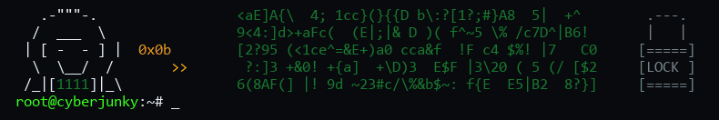

<!-- Banner -->

  

<!-- Projects Section -->
<h2 align="center">🚀 My Projects - this is where most of my free time is spent -</h2>

### 🌍 Websites

| Project | Description |
|---------|-------------|
| [freqle.org](https://freqle.org) | Freqtrade strategy lab |
| [cyberjunky.nl](https://cyberjunky.nl) | My website (needs an update) |
| [ghost-to-jekyll](https://github.com/cyberjunky/ghost-to-jekyll) | Toolkit to convert a website from Ghost to Jekyll/GitHub pages |

### 🏠 Home Assistant Core Integrations

| Project | Description |
|---------|-------------|
| [FireServiceRota](https://www.home-assistant.io/integrations/fireservicerota/) | FireServiceRota scheduling and dispatching system for firefighters |

### 📡 Home Assistant Apps (Add-ons)

| Project | Description |
|---------|-------------|
| [home-assistant-apps](https://github.com/cyberjunky/home-assistant-apps) | My collection of Home Assistant Apps / Addons |
| ↳ [app-dishylink](https://github.com/cyberjunky/home-assistant-apps/tree/main/app-dishylink) | Starlink dish and router dashboard with 24/7 recorded history, powered by Dishylink |
| ↳ [app-pgadmin4](https://github.com/cyberjunky/home-assistant-apps/tree/main/app-pgadmin4) | pgAdmin 4, web-based PostgreSQL administration from the sidebar |
| ↳ [app-timescaledb](https://github.com/cyberjunky/home-assistant-apps/tree/main/app-timescaledb) | PostgreSQL with TimescaleDB, PostGIS, pgvector, pg_cron, pgAgent and TimescaleDB Toolkit |
| ↳ [app-meldkamer](https://github.com/cyberjunky/home-assistant-apps/tree/main/app-meldkamer) | Receive P2000 messages from the air using an SDR dongle, includes dashboard |
| ↳ [app-goodwe](https://github.com/cyberjunky/home-assistant-apps/tree/main/app-goodwe) | GoodWe inverter dashboard and battery controller for Home Assistant |
| ↳ [app-tesla](https://github.com/cyberjunky/home-assistant-apps/tree/main/app-tesla) | Unofficial Tesla logger, statistics and dashboard for Home Assistant |
| ↳ [app-toon](https://github.com/cyberjunky/home-assistant-apps/tree/main/app-toon) | Logger and dashboard for a rooted Toon thermostat: boiler, heating, energy and the Toon's own health |
| ↳ [app-fireservicerota](https://github.com/cyberjunky/home-assistant-apps/tree/main/app-fireservicerota) | FireServiceRota / Brandweerrooster dashboard: live incident, respond, duty and history |
| ↳ [app-nuclei](https://github.com/cyberjunky/home-assistant-apps/tree/main/app-nuclei) | Internal vulnerability scanner: CVEs, exposed services and open ports, as tickets you work through |
| ↳ [app-arcade](https://github.com/cyberjunky/home-assistant-apps/tree/main/app-arcade) | Classic arcade games with MAME in your browser, high scores kept (bring your own ROMs) |
| ~~[addon-p2000_rtlsdr](https://github.com/cyberjunky/addon-p2000_rtlsdr)~~ | ~~Receive P2000 messages from the air using an RTL-SDR dongle~~ (deprecated) |

### 🏠 Home Assistant Custom Integrations

| Project | Description |
|---------|-------------|
| [home-assistant-garmin_connect](https://github.com/cyberjunky/home-assistant-garmin_connect) | Get sensor data from Garmin Connect inside Home Assistant |
| [home-assistant-fireservicerota](https://www.home-assistant.io/integrations/fireservicerota/) | Duty schedule and alerts for firefighters |
| [home-assistant-toon_climate](https://github.com/cyberjunky/home-assistant-toon_climate) | Toon Thermostat climate control |
| [home-assistant-toon_boilerstatus](https://github.com/cyberjunky/home-assistant-toon_boilerstatus) | Read boiler information from Toon |
| [home-assistant-toon_smartmeter](https://github.com/cyberjunky/home-assistant-toon_smartmeter) | Read smartmeter data from Toon |
| [home-assistant-arpscan_tracker](https://github.com/cyberjunky/home-assistant-arpscan_tracker) | Superfast presence detection |
| [home-assistant-hvcgroep](https://github.com/cyberjunky/home-assistant-hvcgroep) | Garbage collector data for HVC Groep |
| [home-assistant-bitvavo](https://github.com/cyberjunky/home-assistant-bitvavo) | Expose Bitvavo values inside Home Assistant |
| ~~[home-assistant-shell_recharge](https://github.com/cyberjunky/home-assistant-shell_recharge)~~ | ~~Expose data from EV chargers listed on shellrecharge.com~~ (deprecated) |
| [home-assistant-omnik_inverter](https://github.com/cyberjunky/home-assistant-omnik_inverter) | Monitor older Omnik Solar inverters via the network using special TCP packets |
| [home-assistant-bitaxe_monitor](https://github.com/cyberjunky/home-assistant-bitaxe_monitor) | Monitor Bitaxe solo Bitcoin miners |
| [home-assistant-chronicle](https://github.com/cyberjunky/home-assistant-chronicle) | Long-term history of every state in TimescaleDB: compressed, with hourly and daily averages |
| [home-assistant-adlerlicht_de](https://github.com/cyberjunky/home-assistant-adlerlicht_de) | Monitor German Police events |
| [home-assistant-gaia_station](https://github.com/cyberjunky/home-assistant-gaia_station) | Read data from local GAIA Air Quality Monitors |
| [home-assistant-tibber_pricing_de](https://github.com/cyberjunky/home-assistant-tibber_pricing_de) | Track energy pricing from Tibber Germany |
| [home-assistant-moving_intelligence](https://github.com/cyberjunky/home-assistant-moving_intelligence) | Moving Intelligence Tracker |

### 🐍 Python Packages

| Project | Description |
|---------|-------------|
| [ha-garmin](https://github.com/cyberjunky/ha-garmin) | Python client for Garmin Connect API, designed for Home Assistant integration |
| [python-garminconnect](https://github.com/cyberjunky/python-garminconnect) | Python client for reading your Garmin Connect data |
| [python-fireservicerota](https://github.com/cyberjunky/python-fireservicerota) | Python client for talking to FireServiceRota/Brandweerrooster API |
| ~~[python-shellrecharge](https://github.com/cyberjunky/python-shellrecharge)~~ | ~~Python client for reading EV charger information from shellrecharge.com~~ (deprecated) |
| [bitvavo-aio](https://github.com/cyberjunky/bitvavo-aio) | Python client for crypto information from Bitvavo |
| [python-moving_intelligence-ha](https://github.com/cyberjunky/python-moving_intelligence-ha) | Python client for Moving Intelligence Tracker |

### 📈 Crypto Tools

| Project | Description |
|---------|-------------|
| ~~[3commas-cyber-bots](https://github.com/cyberjunky/3commas-cyber-bots)~~ | ~~Tools to help you trade with 3commas bots~~ (deprecated) |

### 🕐 Garmin IQ Apps

| Project | Description |
|---------|-------------|
| [japanese-interval-walking](https://github.com/cyberjunky/japanese-interval-walking) | My first Garmin IQ app - Interval walking |
---

  

<!-- Tech Stack -->
<h2 align="center">🛠️ Tech Stack</h2>

  
  
  
  
  

<!-- Connect Section -->
<h2 align="center">🌐 Connect With Me</h2>

  
  
  

  

<!-- GitHub Stats -->
<h2 align="center">📊 GitHub Activity</h2>

  

  
  

---

<!-- Support Section -->
<h2 align="center">💖 Support My Work</h2>

  If you find my projects useful, consider supporting their development:

  
  

---

  

